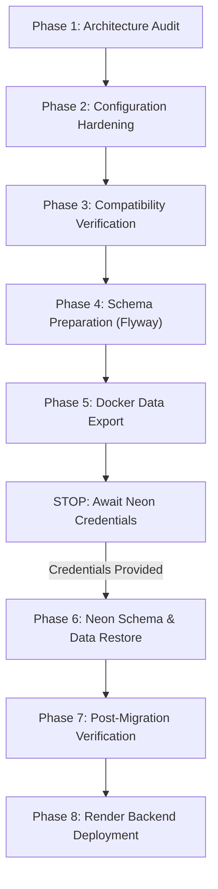

# Aether — Neon PostgreSQL Migration Plan

## 1. Executive Summary & Objective

This document outlines the architectural plan for transitioning Aether's primary production database from Docker-hosted PostgreSQL to **Neon Serverless PostgreSQL**, while maintaining Render as the web service runtime host and preserving Docker PostgreSQL for local development and offline testing.

### Target Deployment Topology
- **Backend Service**: Render Web Service (Spring Boot 3.3.5 Docker container)
- **Database Service**: Neon PostgreSQL (Serverless PostgreSQL 16)
- **Connectivity**: Native PostgreSQL JDBC over TLS (`sslmode=require`)
- **Database Migrations**: Flyway versioned migrations (`V1` to `V10`)
- **Vector Search**: PostgreSQL `pgvector` with 384-dimensional cosine similarity and HNSW indexing
- **Keyword & Full-Text Search**: PostgreSQL `tsvector` with GIN indexing and `pg_trgm` trigram similarity

---

## 2. Core Constraints & Safety Rules

1. **Zero Credential Hardcoding**: Production database credentials are provided strictly via environment variables (`DB_URL`, `DB_USERNAME`, `DB_PASSWORD`) and never stored in source code, commit history, or build logs.
2. **Local Development Preservation**: The existing `docker-compose.yml` environment remains untouched and fully functional. Developers without internet access or Neon credentials can run the entire platform locally with zero friction.
3. **Immutability of Historical Data**: Existing Docker database data is never overwritten or deleted. Export operations are strictly read-only.
4. **Approval-Gated Restoration**: Migration scripts require explicit manual confirmation (`CONFIRM`) before executing against Neon.
5. **No Blind Claims**: Neon connectivity is not claimed as verified until real credentials are provided by the user and confirmed via automated smoke checks.

---

## 3. Migration Phases

### Phase 1: Architecture Audit
- Inspected all datasource configurations, migrations, and extension dependencies.
- Confirmed vector dimensions (`vector(384)`), HNSW indexes, triggers, and Row-Level Security policies.

### Phase 2: Configuration Hardening
- Implemented `DatabaseUrlEnvironmentPostProcessor` supporting `DB_URL`, `DB_USERNAME`, `DB_PASSWORD`.
- Configured HikariCP connection pool with serverless-tuned timeouts (`connection-timeout: 20000ms`, `max-lifetime: 900000ms`, `idle-timeout: 300000ms`).
- Guaranteed TLS enforcement (`sslmode=require`) for all Neon endpoints.

### Phase 3: PostgreSQL & Extension Compatibility
- Verified `vector`, `pg_trgm`, `uuid-ossp`, and `tsvector` support in Neon.
- Added graceful privilege fallback in `V4__tenant_role.sql` to accommodate managed cloud role limitations.

### Phase 4: Flyway Schema Management
- Validated that Flyway initializes clean Neon instances without schema drifts.
- Ensured extensions are installed prior to dependent table definitions.

### Phase 5: Safe Data Export (Local Docker)
- Created `scripts/dump-docker-db.sh` and `scripts/dump-docker-db.ps1` to produce a compressed, read-only custom-format dump (`-Fc`) with `--no-owner --no-acl`.

### Phase 6: Neon Restoration (Executed once credentials supplied)
- Automated restore script `scripts/restore-neon-db.sh` and `scripts/restore-neon-db.ps1`.
- Enforces interactive approval prompt before applying changes.

### Phase 7: Verification & Smoke Testing
- Execute `scripts/verify-neon-migration.sql` against Neon to validate row counts, foreign key integrity, vector cosine search, and trigram similarity.

### Phase 8: Render Deployment
- Update Render Web Service environment variables to point to Neon.
- Verify Actuator health probe (`/actuator/health`).

---

## 4. Rollback and Contingency Procedures

If any issue arises during or after the Neon migration:
1. **Instant Backend Reversion**: Update Render's `DB_URL`, `DB_USERNAME`, and `DB_PASSWORD` to point back to the fallback database or local replica.
2. **Local Environment Safety**: Because the Docker PostgreSQL database was never modified or deleted, local operations remain 100% operational at all times.
3. **Artifact Integrity**: File artifact binaries stored on Render's persistent disk are decoupled from database records and remain intact.

