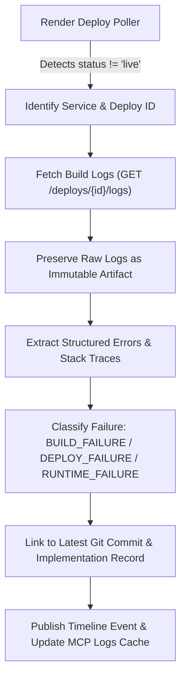

# Render Integration Specification & Capability Matrix

**Specification Baseline**: Render REST API v1  
**Auth Model**: Render API Key (`rnd_...`)  
**API Baseline URL**: `https://api.render.com/v1`  
**Document Status**: **VERIFIED** against official Render documentation as of October 2026.

---

## 1. Executive Summary & Architecture

Aether connects to Render cloud hosting to collect service topologies, track deployment outcomes, capture build and runtime logs upon deployment failures, and surface structured diagnostic packages directly to engineering teams and AI context packages.

---

## 2. In-Product Capability Matrix

| Capability | Supported Method | Rate Limit / SLA | In-Product Status | Description |
| :--- | :---: | :---: | :---: | :--- |
| **Service Discovery** | `POLLING` | 100 req/min | **Supported** | Lists web services, static sites, background workers, and PostgreSQL databases. |
| **Deployment Polling** | `POLLING` | 100 req/min | **Supported** | Polls `GET /v1/services/{id}/deploys` every 30s during active deployment cycles. |
| **Build Log Retrieval** | `POLLING` | 100 req/min | **Supported** | Fetches build stdout/stderr for failed deployments via `GET /v1/services/{id}/deploys/{deployId}/logs`. |
| **Runtime Log Retrieval** | `POLLING` | 100 req/min | **Supported** | Queries runtime log stream `GET /v1/services/{id}/logs` scoped to specific time windows. |
| **Outbound Webhooks** | `UNSUPPORTED` | N/A | **Not Available** | Render does **not** provide generic outbound webhooks for deployment state transitions. |
| **Direct Deploy Trigger** | `MANUAL` | On demand | **Supported** | Triggers deployments via project-authorized Deploy Hook URL (`POST /deploy/srv-...`). |

> [!NOTE]
> Render Deploy Hooks are inbound trigger endpoints only (invoked via HTTP POST to trigger a build). Render does not emit outbound HTTP webhooks to arbitrary endpoints on deployment status changes (outbound notifications are restricted to Slack/Teams). Therefore, Aether uses active cursor-based **POLLING** for status updates.

---

## 3. Failure Detection & Log Ingestion Pipeline

When a deployment transition to a failure state (`build_failed`, `update_failed`, `canceled`) is detected:

### 3.1 Strict Deployment Scoping
- Every retrieved log artifact is strictly keyed by `(service_id, deploy_id, time_window)`.
- Logs can **never** be attached to the wrong deployment or leaked across project boundaries.
- Database foreign key constraints guarantee that failure evidence is coupled to its specific deployment entity.

### 3.2 Error Classification Taxonomy
1. `BUILD_FAILURE`: Compiler errors, missing dependencies, bundler crashes, syntax errors during Docker/native build.
2. `DEPLOY_FAILURE`: Health check failures, port binding timeouts, invalid startup commands, secret injection errors.
3. `RUNTIME_FAILURE`: Unhandled exceptions, out-of-memory kills (OOM), database connection refused post-boot.

---

## 4. Log Retention Limits & Reporting

- **Free Tier Services**: 7 days log retention; API returns a maximum of 1,000 lines per call.
- **Paid Tier Services**: 30 days log retention; streaming log export available.
- **UI Reporting**: Aether's deployment dashboard surfaces the active retention window and flags when older logs are no longer retrievable from the provider.

